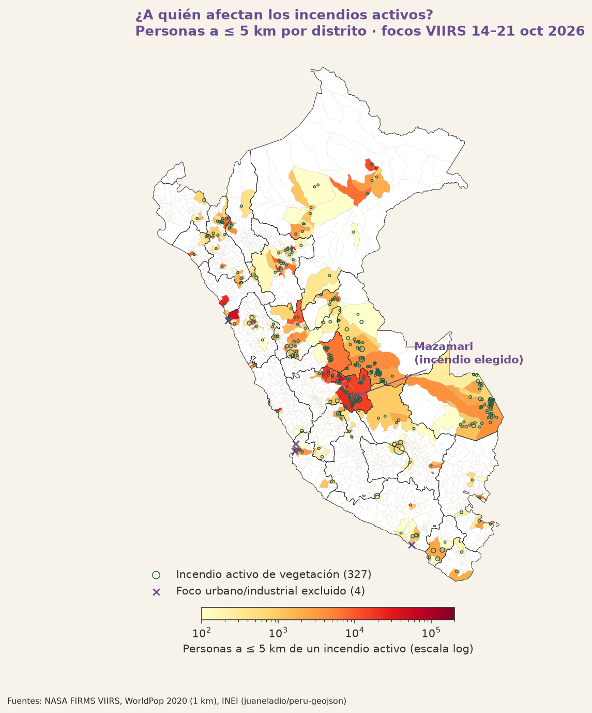
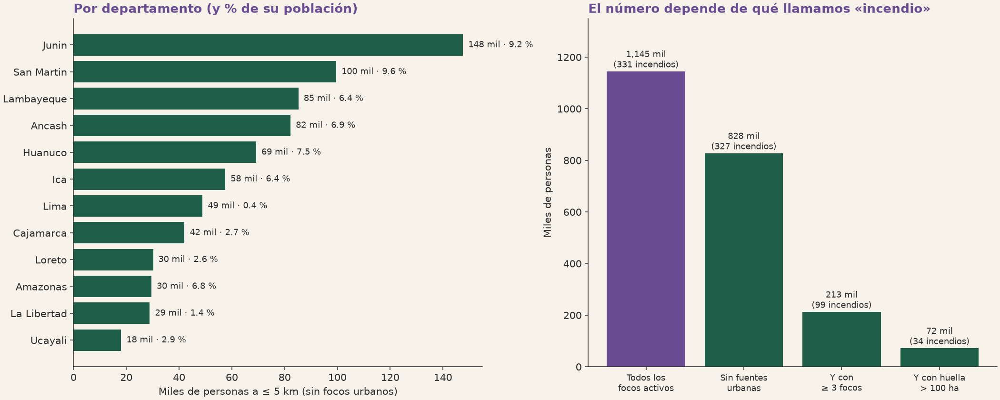
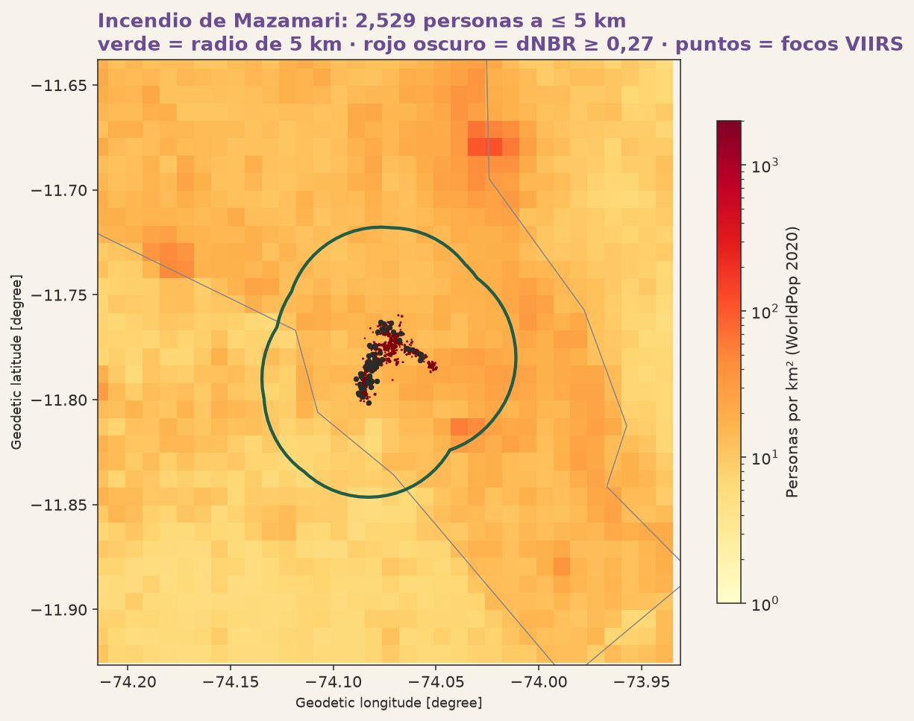
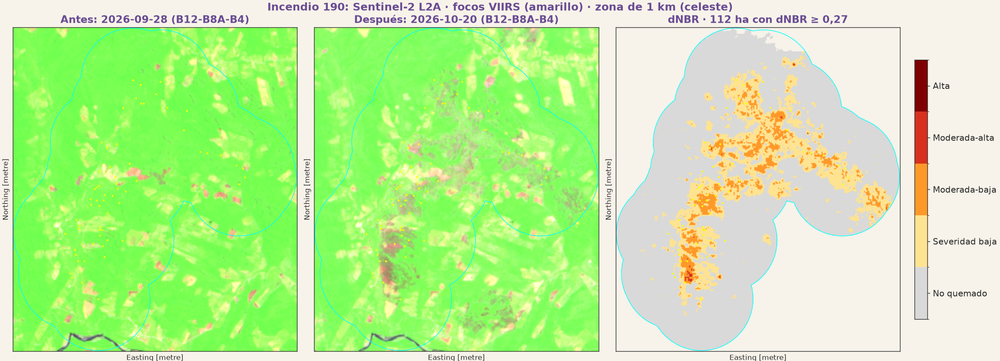

# 828 mil personas viven a 5 km o menos de un incendio activo en el Perú

**Tarea 3.1 · Ciencia de Datos con Python · Opción D: ¿A quién afecta? · Antonio Macedo**

> **Corte de datos:** focos VIIRS del **14 oct 2026 05:14 UTC al 21 oct 2026 19:19 UTC** (14:19 h de Lima). Un incendio cuenta como *activo* si tuvo algún foco entre el 19 oct 19:19 y el 21 oct 19:19 UTC. Todos los datos se descargaron el **21 oct 2026**. Es una herramienta independiente: no reemplaza los reportes del COEN, INDECI, SERFOR ni SERNANP.

**Reportaje publicado en Claude:** https://claude.ai/artifact/T85MK16ZAznqAeJEJFXoon (versión sin fondo satelital, porque la plataforma bloquea imágenes externas).

**Dashboard (reportaje interactivo):** [`dashboard/index.html`](dashboard/index.html). Descárgalo y ábrelo con doble clic, o míralo en línea en [raw.githack](https://raw.githack.com/AntonioMacedo17/Python_Intermedio_2026/main/tarea_3_1/dashboard/index.html).

## La pregunta

¿Cuántas personas viven a 1, 3 y 5 km de los incendios activos de esta semana, dónde están, y cuánto se quemó en un incendio concreto (Mazamari, Satipo, Junín)?

## Glosario breve

- **Foco de calor:** un píxel de 375 m en el que el satélite VIIRS detectó una temperatura anómala en una pasada. *No* es lo mismo que un incendio: también puede ser una quema agrícola, una industria o una antorcha de gas.
- **Incendio:** en este trabajo, un grupo de focos separados por ≤ 1 km y ≤ 48 h entre sí.
- **Incendio activo:** un incendio con al menos un foco en las últimas 48 h del corte.
- **Área quemada:** píxeles de Sentinel-2 (20 m) con dNBR ≥ 0,27, es decir, con severidad moderada o alta según el USGS. La vegetación que se quemó deja de reflejar el infrarrojo cercano y refleja más el infrarrojo de onda corta.
- **Personas a ≤ 5 km:** habitantes estimados por WorldPop 2020 dentro de un radio de 5 km alrededor de los focos. Es *exposición*, no daño.

## Tres hallazgos

1. **827 672 personas (2,31 % del Perú) viven a ≤ 5 km de alguno de los 327 incendios de vegetación activos; 31 015 viven a ≤ 1 km.** Junín reúne **147 623** (el 17,8 % del total nacional expuesto y el 9,16 % de su propia población). En el distrito de Satipo queda expuesto el **75,2 %** de los habitantes.
   *Fuente: NASA FIRMS VIIRS, 14–21 oct 2026 · WorldPop 2020.*
2. **La cifra depende de qué se llame «incendio».** Con todos los focos activos son **1 145 047** personas; sin las 4 fuentes urbanas o industriales, **827 672**; solo con los incendios de ≥ 3 focos, **213 014**; y solo con los de más de 100 ha de huella, **72 079**. 172 de los 327 incendios activos tienen **un solo foco**.
   *Fuente: NASA FIRMS VIIRS, 19–21 oct 2026 (activos) · WorldPop 2020.*
3. **En Mazamari se quemaron 112 ha con severidad moderada o alta y 507 ha con algún daño, y 2 535 personas viven a ≤ 5 km (373 a ≤ 1 km).** Es una población rural dispersa, de 10 a 100 personas por celda de ~1 km² (WorldPop). Según la imagen "antes" que se elija, el área quemada va de **69 a 152 ha**.
   *Fuente: Sentinel-2 L2A del 28 sep y el 20 oct 2026 · WorldPop 2020.*

## Personas por distancia al fuego

| Radio | Todos los incendios de vegetación activos | Solo Mazamari |
|---|---|---|
| ≤ 1 km | 31 015 | 373 |
| ≤ 3 km | 284 741 | 1 234 |
| ≤ 5 km | 827 672 | 2 535 |

*Fuente: NASA FIRMS VIIRS (activos al 19–21 oct 2026) · WorldPop 2020, 1 km.*
**Cómo leer:** los anillos son acumulados, así que los de ≤ 3 km incluyen a los de ≤ 1 km. **No muestra** cuánta gente respiró humo ni quién sufrió daños. La cifra a 1 km es la más gruesa, porque los píxeles de WorldPop miden 1 km.

## Mapas y gráficos



*Fuente: NASA FIRMS VIIRS 14–21 oct 2026 · WorldPop 2020 · límites INEI (juaneladio/peru-geojson).*
**Cómo leer:** el color de cada distrito indica cuántos de sus habitantes viven a ≤ 5 km de un incendio activo de vegetación, en escala logarítmica. Los círculos verdes son incendios, con tamaño según el número de focos, y las X moradas son las fuentes urbanas excluidas. Un distrito puede tener gente expuesta sin tener incendios propios, si el fuego está en el distrito vecino. **No muestra** incendios tapados por nubes ni incendios ya apagados antes del 19 oct.



*Fuente: NASA FIRMS VIIRS 14–21 oct 2026 · WorldPop 2020.*
**Cómo leer:** a la izquierda, personas expuestas por departamento y su % de la población departamental. A la derecha, cómo cambia el total al endurecer la definición de "incendio". **No muestra** daños ni personas evacuadas.



*Fuente: WorldPop 2020 · Sentinel-2 L2A del 28 sep y el 20 oct 2026 · NASA FIRMS VIIRS 14–20 oct 2026.*
**Cómo leer:** el fondo muestra personas por km², la línea verde marca el radio de 5 km alrededor de los focos, el rojo oscuro es el área con dNBR ≥ 0,27 y los puntos son focos VIIRS. **No muestra** dónde viven exactamente las personas dentro de cada km², ni si el humo llegó a ellas.



*Fuente: Sentinel-2 L2A (Microsoft Planetary Computer) del 28 sep y el 20 oct 2026 · focos NASA FIRMS VIIRS.*
**Cómo leer:** las dos primeras imágenes están en falso color (B12-B8A-B4): la vegetación sana se ve verde y lo quemado, oscuro o morado. La tercera muestra la severidad del dNBR (USGS) dentro de 1 km de los focos. **No muestra** lo que se quemó antes del 28 sep ni lo que está bajo nubes (1,2 % de la zona, enmascarado).

## ¿Lo confirman las fuentes oficiales?

| Fuente | Fecha | Lo que dice | Lo que medí yo | ¿Comparable? |
|---|---|---|---|---|
| [COEN-INDECI, Reporte complementario n.º 13907](https://portal.indeci.gob.pe/wp-content/uploads/2026/10/REPORTE-COMPLEMENTARIO-N.%C2%BA-13907-11OCT2026-INCENDIO-FORESTAL-EN-EL-DISTRITO-DE-R%C3%8DO-TAMBO-JUN%C3%8DN-6.pdf) (leído en el PDF oficial) | 11 oct 2026, 05:30 h | Incendio en la C. N. Tsyapo, Río Tambo (Satipo): 80 damnificados, 60 afectados, 2 lesionados, 20 viviendas destruidas, 350 ha de cobertura natural destruida. Mazamari figura como base aérea de apoyo. | En Río Tambo, un grupo de 279 focos (14–17 oct) con 3 545 ha de huella VIIRS. | Parcial: son fechas distintas y la huella VIIRS **no es área quemada**. Que sea el mismo incendio de Tsyapo: **no verificado**. |
| Jefe de INDECI, citado por [Infobae](https://www.infobae.com/peru/2026/10/12/incendios-forestales-en-peru-indeci-reporta-58-activos-y-las-fuerzas-armadas-despliegan-aviones-y-helicopteros/) | publicado el 11 oct 2026 | 58 incendios forestales activos | 327 incendios activos (19–21 oct) | No: son definiciones y fechas distintas. INDECI cuenta emergencias atendidas y yo cuento grupos de focos satelitales. |
| COEN, citado por [Mongabay Latam](https://es.mongabay.com/2026/10/peru-medio-centenar-incendios-forestales-trece-regiones-extienden-territorios-indigenas/) | 13 oct 2026 | 51 incendios (35 activos, 16 controlados) en 13 regiones. El monitoreo satelital de SERFOR: 56 activos en 16 regiones. | — | Muestra que incluso las fuentes oficiales difieren según el método. |
| INDECI-COEN, citado por [El Búho](https://elbuho.pe/2026/10/ya-son-12-los-fallecidos-en-los-incendios-forestales-que-se-estan-registrando-en-siete-regiones-del-peru/) | corte al 19 oct 2026 | 12 incendios activos, 832 personas afectadas, 12 fallecidos | 827 672 personas a ≤ 5 km | No: "afectado" es una persona registrada con daños (EDAN) y "a ≤ 5 km" es exposición potencial. |
| Incendio de Mazamari (n.º 190) | — | No encontré un reporte oficial de este incendio | 112 ha (dNBR ≥ 0,27), 2 535 personas a ≤ 5 km | **No verificado** |
| SERNANP | — | No consulté sus reportes | — | **No verificado** |

Las cifras citadas por prensa (Infobae, Mongabay, El Búho) **no las contrasté con el documento original** del COEN.

## Método

| Paso | Script | Decisión y umbral exacto |
|---|---|---|
| 0 | `00_descargar.py` | Descarga FIRMS «South America 7d» (S-NPP, NOAA-20, NOAA-21), los límites INEI y WorldPop 2020. |
| 1 | `01_focos_incendios.py` | Focos dentro del Perú (9 949). Se quitan los de confianza `low` (quedan 8 613) y los que están a ≤ 5 km de los volcanes Sabancaya, Ubinas y Misti (no había ninguno). Agrupación: ≤ 1 km y ≤ 48 h entre focos (componentes conexas). **Fuentes fijas:** ≥ 6 días distintos con desviación < 0,002° (~220 m); salen 2 (la planta de gas de Pisco en Paracas y un punto en La Unión, Junín). Resultado: **2 585 incendios, 331 activos.** |
| 2 | `02_dnbr.py` | **NBR = (B8A − B12)/(B8A + B12)** a 20 m; **dNBR = NBR antes − NBR después**. **Máscara SCL:** se descartan las clases 0, 1, 3, 6, 8, 9, 10 y 11 (sin dato, saturado, sombra de nube, agua, nube media, nube alta, cirro, nieve) en *cualquiera* de las dos fechas. **Zona:** ≤ 1 km de los focos del incendio. **Clases USGS:** < 0,10 no quemado · 0,10–0,27 baja · 0,27–0,44 moderada-baja · 0,44–0,66 moderada-alta · ≥ 0,66 alta. **Área quemada = dNBR ≥ 0,27.** |
| 3 | `03_poblacion.py` | Radios de **1, 3 y 5 km** por foco (UTM 18S), unidos para no contar dos veces a nadie. Se suman los píxeles de WorldPop cuyo **centro** cae dentro. **Filtro urbano:** el incendio sale si > 50 % de sus focos caen en píxeles con ≥ 500 hab/km² (4 excluidos: Chimbote, Chincha Baja, Pisco, Mollendo). |
| 4–5 | `04_figuras.py`, `05_dashboard.py` | Figuras estáticas y el reportaje HTML. |

### Imágenes de Sentinel-2 y nubes (zona de 1 km del incendio de Mazamari)

| Fecha | % nube en la zona | % nube escena | Uso |
|---|---|---|---|
| 2026-08-31 | 0,0 | 40,3 | sensibilidad |
| **2026-09-28** | **0,0** | 44,3 | **antes** |
| 2026-10-08 | 0,0 | 33,8 | sensibilidad |
| 2026-10-13 | 51,0 | 36,6 | descartada |
| 2026-10-18 | 43,3 | 81,0 | descartada |
| **2026-10-20** | **1,2** | 62,9 | **después** |

Las escenas son de la órbita R082, tiles 18LWM, 18LWN, 18LXM y 18LXN; la lista completa está en `datos/procesados/escenas_s2_incendio_190.csv`. Sensibilidad a la fecha "antes", con la imagen "después" fija en el 20 oct:

| Imagen antes | ha con dNBR ≥ 0,27 | ha con dNBR ≥ 0,10 |
|---|---|---|
| 8 oct | 69 | 405 |
| **28 sep** | **112** | **507** |
| 31 ago | 152 | 637 |

**Por qué Mazamari y no otro.** Primero probé Cayna (Ambo), pero empezó el 18 oct y la única imagen posterior (21 oct) estaba **100 % nublada**. De los incendios activos, solo Curahuasi y Mazamari habían quemado antes de una imagen limpia, y Curahuasi era el ejemplo de la clase. Elegí el 28 sep como fecha "antes" porque en la imagen del 8 oct ya se veía una parte quemada.

## Fuentes

| Dataset | Link oficial | Versión / fecha de los datos | Descargado |
|---|---|---|---|
| Focos de calor VIIRS 375 m (S-NPP, NOAA-20, NOAA-21), «South America 7d» | [NASA FIRMS](https://firms.modaps.eosdis.nasa.gov/active_fire/) | 14 oct 05:14 – 21 oct 19:19 UTC, 2026 (NRT) | 21 oct 2026 |
| Sentinel-2 Level-2A | [Microsoft Planetary Computer · sentinel-2-l2a](https://planetarycomputer.microsoft.com/dataset/sentinel-2-l2a) | escenas del 31 ago al 20 oct 2026 | 21 oct 2026 |
| WorldPop, población 2020, 1 km, Perú (`per_ppp_2020_1km_Aggregated`) | [archivo en data.worldpop.org](https://data.worldpop.org/GIS/Population/Global_2000_2020_1km/2020/PER/per_ppp_2020_1km_Aggregated.tif) · [WorldPop](https://www.worldpop.org/) | 2020 | 21 oct 2026 |
| Límites distritales y departamentales INEI | [juaneladio/peru-geojson](https://github.com/juaneladio/peru-geojson) | versión del repositorio | 21 oct 2026 |

## Limitaciones

- **Un foco de calor no es un incendio.** Quité 2 fuentes fijas y 4 urbanas, pero 172 incendios activos son de un solo foco, que pueden ser quemas agrícolas o basurales. Además, varios focos de la costa de Moquegua, Ilo y Arequipa aparecen todos en la misma pasada (20 oct, 18:36 UTC) y podrían ser falsos positivos sobre el desierto.
- **Las nubes esconden el fuego.** Cayna no se pudo medir por las nubes, y en la selva un incendio puede quedar oculto días enteros a VIIRS y a Sentinel-2.
- **Exposición no es daño.** Las 827 672 personas viven cerca, pero no se sabe si fueron afectadas. El radio de 5 km es una convención.
- **WorldPop es de 2020** y es un modelo, no un censo. A 1 km de resolución, la cifra a ≤ 1 km es aproximada.
- **FIRMS de 7 días** no ve el inicio de los incendios más antiguos (Mazamari ya ardía antes del 8 oct). Las cifras por incendio se solapan y no se pueden sumar; el total nacional sí usa la unión de los radios.
- El área quemada solo cuenta dentro de 1 km de los focos, así que puede perder bordes del incendio o incluir quemas agrícolas vecinas.

## Cómo reproducir

```bash
cd tarea_3_1
python -m venv .venv && .venv/Scripts/pip install -r requirements.txt
cd src
python 00_descargar.py
python 01_focos_incendios.py
python 02_dnbr.py listar 190 2026-08-25 2026-10-21
python 02_dnbr.py calcular 190 2026-09-28 2026-10-20
python 03_poblacion.py
python 04_figuras.py
python 05_dashboard.py
```

> FIRMS «7d» cambia todos los días. Los focos de este análisis quedaron guardados en `datos/procesados/focos_peru.csv`. Si se re-descargan los datos, los ID de incendio pueden cambiar.
