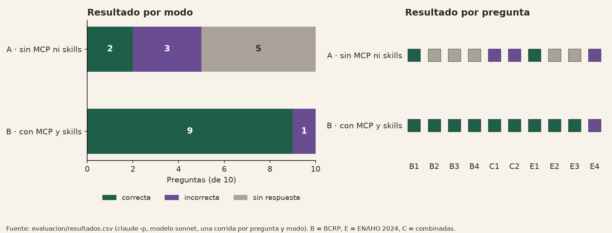

# Comparación: Claude Code sin y con el MCP del BCRP y las skills de la ENAHO

Corrida del 2026-11-08, `claude -p` con el modelo **sonnet** en los dos modos, 2 llamadas en paralelo, una sesión
independiente por pregunta. Diseño, respuestas esperadas y tolerancias: `README_evaluacion.md`, fijados en el commit
`02ff9d6`, antes de correr. Datos por pregunta: `resultados.csv`. Registro de herramientas de cada sesión:
`registros/<modo>_<id>.json`. Todas las cifras de este archivo salen de `comparar.py` o de esos registros.

## Resultado por modo

| Modo | Correctas | Incorrectas | Sin respuesta | Error | Tiempo promedio | Mediana |
|---|---|---|---|---|---|---|
| A · sin MCP ni skills | **2/10** | 3 | 5 | 0 | 5.6 s | 4.5 s |
| B · con MCP y skills | **9/10** | 1 | 0 | 0 | 15.0 s | 11.0 s |

| Tipo | A | B |
|---|---|---|
| BCRP (B1–B4) | 1/4 | 4/4 |
| ENAHO (E1–E4) | 1/4 | 3/4 |
| Combinadas (C1–C2) | 0/2 | 2/2 |

**Mejoraron 7 preguntas** (B2, B3, B4, E2, E3, C1, C2), **ninguna empeoró** y 3 quedaron igual (B1 y E1
correctas en ambos modos; E4 incorrecta en ambos).

## Qué hizo cada modo

**Modo A (sin herramientas).** Respondió de memoria solo cuando creía saber la cifra, y lo dijo en `fuente`
(«dato de memoria, no consultado»). Acertó dos cifras de 2024 muy difundidas: la tasa de referencia (B1, 5.0) y la
pobreza nacional (E1, 27.6). En las cifras de 2025–2026 (B2, B3, B4) y en las de subgrupos (E2, E3) puso `null`, como
pedía la instrucción: no inventó. Sus 3 incorrectas fueron:
- E4: dio 5.7 % de pobreza extrema (la referencia es 5.5 %), de memoria.
- C1: no dio la pobreza de Cajamarca y recordó un PBI 2024 de 3.3 % (el BCRP publica 3.5 %).
- C2: acertó la inflación de dic. 2024 (1.97) pero no dio la pobreza urbana. Por la regla fijada, una combinada con
  una sola cifra cuenta como incorrecta.

**Modo B (con MCP y skills).**
- **BCRP: 4/4, siempre con el MCP.** En las cuatro llamó a `serie` o `resumen` (y antes a `buscar_series` en tres) y
  citó el código y la URL de la API. En B4 usó otra serie con el mismo valor (PN06481IM, 90,214.48 millones de US$).
- **ENAHO: el uso de las skills fue desigual.** Según los registros:

| Pregunta | Resultado B | Cómo llegó a la cifra (según `registros/B_<id>.json`) |
|---|---|---|
| E1 nacional | correcta (27.6) | **Sin herramientas.** Citó la cifra que trae la `description` de `limpiando-enaho` y lo dijo: «es la cifra oficial de 27,6 % que cita la skill… No la recalculé» |
| E2 rural | correcta (39.3) | Sin la skill: descomprimió la sumaria y calculó con su propio código (`factor07 × mieperho`) |
| E3 Cusco | correcta (18.5) | Leyó `SKILL.md` y `limpiar.py` y corrió el script de la skill por Bash (sin la herramienta Skill) |
| E4 extrema | **incorrecta (5.9)** | **Sin herramientas**: de memoria, aunque la skill calcula la pobreza extrema |
| C1 Cajamarca + PBI | correcta (45.0 y 3.5) | Cargó la skill con la herramienta Skill, corrió `limpiar.py` y usó `resumen` del MCP para el PBI |
| C2 urbana + IPC | correcta (24.7 y 1.97) | Leyó `SKILL.md`, corrió `limpiar.py` y usó `serie` del MCP para el IPC |

  El script de la skill corrió en 3 de las 6 preguntas que usan la ENAHO (E3, C1, C2). En las otras tres el agente
  calculó por su cuenta (E2), citó la `description` (E1) o respondió de memoria (E4).
- **Combinadas: 2/2.** Las dos interpretaciones pasaron la regla automática: no afirman causalidad y reconocen la
  diferencia de cobertura o agregación. Por ejemplo, en C1: «una es un agregado nacional de un año y la otra un nivel
  departamental (muestral, con margen de error)».

## Errores y problemas principales

1. **E4 (pobreza extrema) falló en los dos modos.** En el modo B el agente no activó la skill y respondió de memoria
   con 5.9. Es un fallo de activación: la `description` de `limpiando-enaho` sí menciona «pobreza extrema».
2. **E1 en el modo B no prueba la skill.** Acertó porque la cifra está escrita en la `description` de la skill. Lo
   había anticipado en la limitación 1 del README. La pregunta cuenta como correcta según la regla, pero no prueba
   que la skill procese datos. E3 y C1 (departamentos) sí lo prueban: ahí la skill corrió y la cifra salió del
   cálculo.
3. **La tolerancia de ±0.6 pp decidió una respuesta.** En C2 el modo B dio 24.7 (método de personas con `facpob07`:
   24.74). La referencia es 24.8: con ±0.1 sería incorrecta, con ±0.6 es correcta. La tolerancia se fijó antes de
   correr y por esta razón (no castigar el método de personas, que es válido), pero conviene que lo revises.
4. **La regla automática de coherencia marcó como causales las dos interpretaciones del modo A.** No cambia ningún
   resultado: esas preguntas ya eran incorrectas por la cifra que faltaba. Los disparadores fueron palabras concretas:
   - en C1-A, «explique», a más de 40 caracteres del «No» que la niega, y «una causalidad no se prueba», con la
     negación después de la palabra;
   - en C2-A, «canasta general», porque el patrón `gener…` atrapa «general».

   La regla queda como está, porque se fijó antes de correr. La calificación final de coherencia es la revisión
   manual (ver «Revisión manual de coherencia», abajo).
5. **Aislamiento.** Ningún comando ni lectura del modo B tocó la ruta del repo, y esa ruta no aparece en ninguna
   salida de herramienta (columna `acceso_fuera_copia` vacía en las 20 filas). Dos cosas para que lo sepas:
   - en B-E3 el agente corrió `ls ~ | head`, que mostró las 10 primeras entradas de tu carpeta personal (AppData,
     Documents…, sin `repos`);
   - en B-E2 descomprimió la sumaria en `/tmp`.
6. **Tiempo.** El modo B tarda casi 3 veces más (15.0 s frente a 5.6 s de promedio). Las preguntas con microdatos van
   de 19.8 a 28.9 s, porque procesan los datos desde cero.
7. **Límite de uso.** No hizo falta cambiar a haiku. El uso de la ventana de 5 horas pasó de 0.68 a 0.74 durante la
   corrida (columna `uso_limite_5h`). No hubo reintentos ni límites del BCRP.

## Revisión manual de coherencia (combinadas)

Antonio revisó a mano las 4 interpretaciones de C1 y C2 (modos A y B). Las 4 son **coherentes**: ninguna afirma
causalidad y todas reconocen que las fuentes tienen distinto nivel de agregación o cobertura. Está anotado en la
columna `revision_manual_coherencia` de `resultados.csv`, junto con dos detalles que no cambian el resultado:

- **C1-A** afirma que Cajamarca está entre los departamentos más pobres, aunque no tiene la cifra (a).
- **C2-B** menciona el rango meta del BCRP, un dato que no obtuvo de ninguna herramienta.

El marcador no cambia: C1-A y C2-A siguen incorrectas porque les falta la cifra (a), y C1-B y C2-B siguen
correctas. **Resultado final: A 2/10, B 9/10.**

**Limitación de la regla automática:** tuvo **2 falsos positivos de 4**. Marcó como causales las interpretaciones
C1-A y C2-A, que en realidad niegan la causalidad. Por eso la calificación final de coherencia fue manual, no la de
la regla.

## Conclusión

Con el MCP y las skills, Claude Code pasó de 2/10 a 9/10, y la mejora se concentra en lo que el modelo no puede
saber de memoria: cifras recientes del BCRP (2025–2026) y cifras de la ENAHO por subgrupo o departamento. El MCP fue
la parte más confiable: se usó en las 6 preguntas que pedían una cifra del BCRP y acertó en todas, siempre con el
código de serie y la URL. Las skills ayudaron cuando se activaron (E3, C1, C2), pero su activación no fue constante.
En dos preguntas el agente respondió sin herramientas (una bien, gracias a la cifra escrita en la `description`, y
otra mal, de memoria). Una mejora posible para la entrega es reforzar la `description` de `limpiando-enaho` para que
se active con cualquier cifra de la ENAHO. También el modo A tiene un mérito: con la instrucción «si no sabes, pon
null», casi nunca inventó; su problema fue no tener datos, no alucinar. Son 10 preguntas y una sola corrida, así que
el resultado es indicativo, no una medición definitiva.
