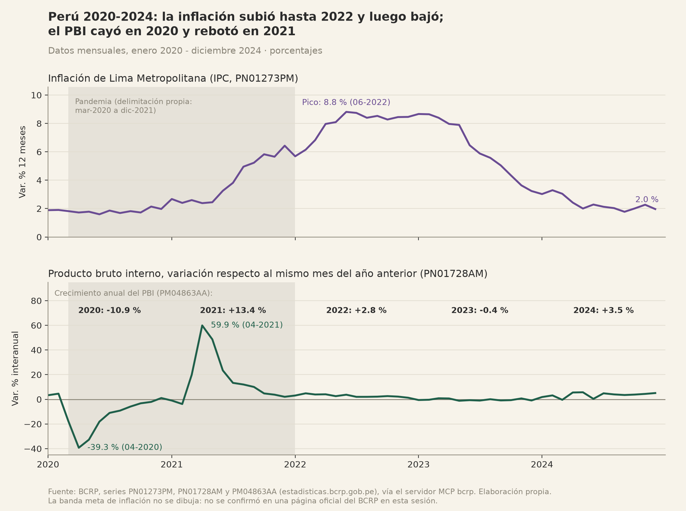
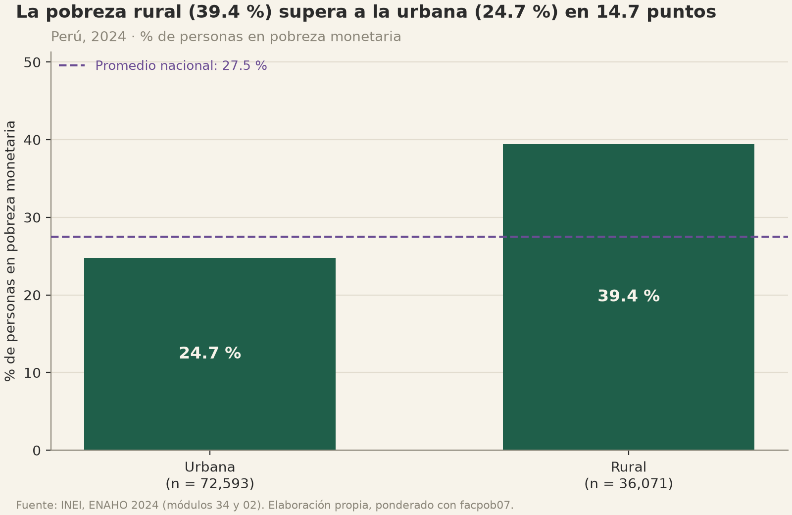
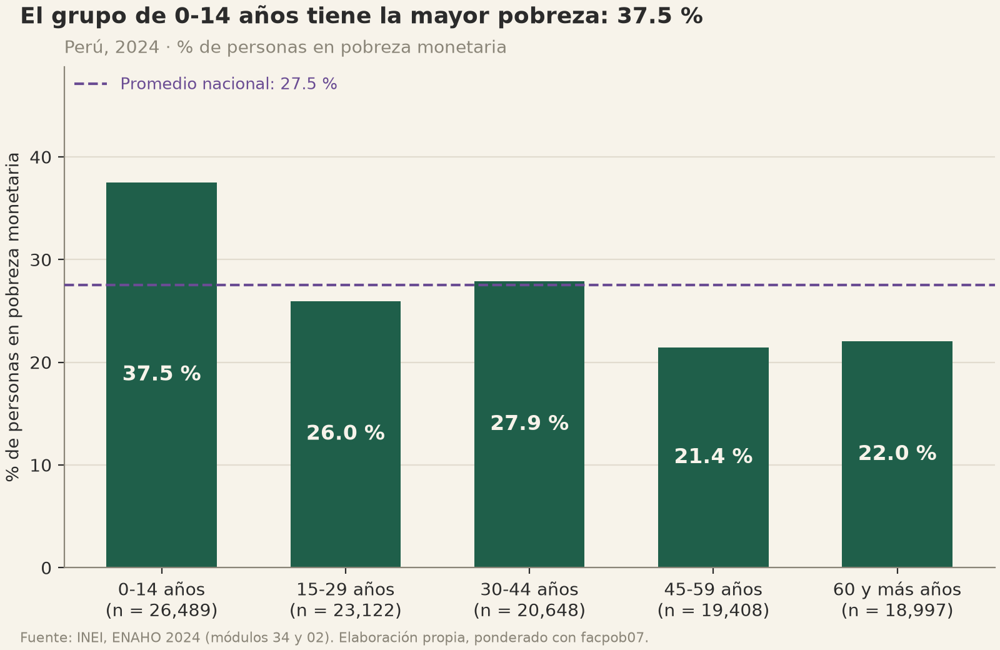
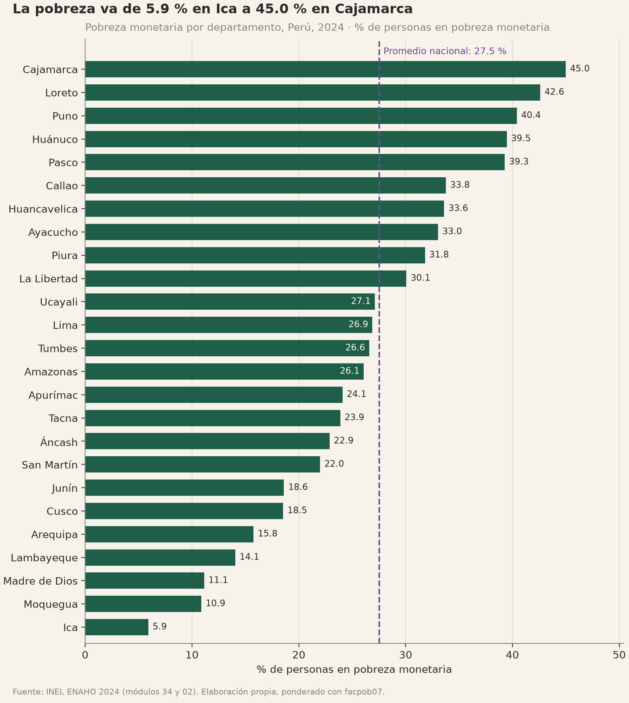
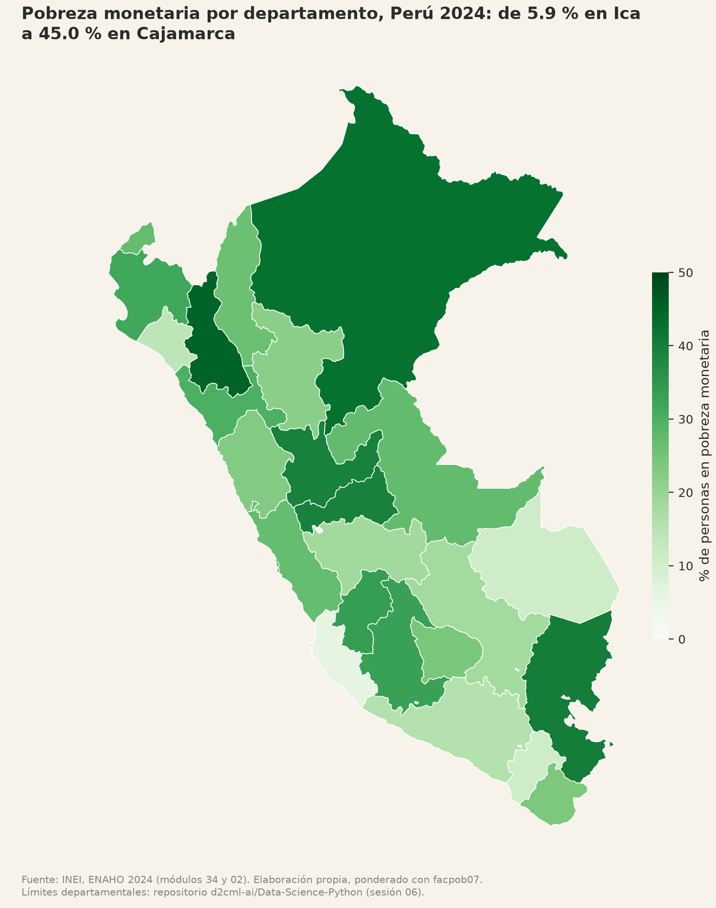

# Perú 2024: contexto macroeconómico y desigualdad de la pobreza monetaria

**Tarea 4 · Agente de investigación socioeconómica (MCP del BCRP + Skills de ENAHO 2024)**
Antonio Macedo · Diplomado QLAB, Python Intermedio 2026 · 8 de noviembre de 2026

Elaborado por Claude Code (agente investigador) en una sola sesión que coordinó el servidor MCP `bcrp` y las skills
`limpiando-enaho`, `graficando-enaho` y `mapeando-enaho`. El orden de las llamadas está en
[`evidencias_ia/integracion/resumen_orquestacion.md`](../evidencias_ia/integracion/resumen_orquestacion.md).
Ninguna cifra se escribió a mano: cada una sale de una herramienta MCP, de un script o de una salida guardada, que se
cita junto a ella.

---

## 1. Pregunta, objetivo y alcance

**Pregunta.** ¿En qué contexto macroeconómico llegó el Perú a 2024 y qué tan desigual era su pobreza monetaria?
(a) Evolución de la inflación y del crecimiento económico entre 2020 y 2024 según el BCRP; (b) brechas de pobreza
monetaria por departamento, área urbana y rural y grupo de edad en 2024 según la ENAHO.

**Objetivo.** Describir, con datos oficiales y reproducibles, (a) la trayectoria macro de 2020-2024 y (b) cómo se
distribuye la pobreza monetaria de 2024 entre territorios y edades.

**Alcance: descriptivo.** Las dos partes se presentan lado a lado como contexto, **no** se busca ni se afirma una
relación causal entre las variables macro y la pobreza. Son fuentes de distinto nivel de agregación (series
nacionales o de Lima, mensuales y anuales, frente a una encuesta de hogares de un solo año) y de distinto periodo
(2020-2024 frente a 2024). La correlación que se reporta es solo entre las dos series del BCRP.

## 2. Fuentes y metodología

### 2.1 BCRP (parte a)

| Serie | Código | Frecuencia | Uso |
|---|---|---|---|
| Índice de precios Lima Metropolitana (var% 12 meses) - IPC | `PN01273PM` | mensual | inflación |
| Producto bruto interno y demanda interna (variación porcentual interanual) - PBI | `PN01728AM` | mensual | crecimiento, mes contra el mismo mes del año anterior |
| Producto bruto interno y otros indicadores - PBI (variación porcentual) | `PM04863AA` | anual | crecimiento anual |
| Ingresos corrientes del gobierno general (porcentaje del PBI) - Ingresos Tributarios | `PM05876FA` | anual | contexto fiscal (opcional) |

- **Obtención:** solo con el servidor MCP `bcrp` (`mcp/server.py`), que descarga de la API oficial
  `https://estadisticas.bcrp.gob.pe/estadisticas/series/api/<código>/json/<desde>/<hasta>`. Los códigos se eligieron
  con `buscar_series` (no de memoria). Periodo: enero 2020 a diciembre 2024 (anuales: 2020 a 2024).
- **Indicadores:** con `resumen` (primer y último valor, promedio, máximo y mínimo) y `serie` (valores periodo a
  periodo); con `correlacion`, Pearson y Spearman entre inflación y PBI mensual, en niveles y en diferencias
  (cambio de un mes al siguiente), para 2020-2024 y 2022-2024. Todas las cuentas las hace el servidor (pandas).
- **Salida guardada:** `informes/scripts/grafico_bcrp.py` repite las llamadas con el cliente de fastmcp en memoria
  y guarda todo lo devuelto en `salidas/bcrp_contexto.json`.

### 2.2 ENAHO 2024 (parte b)

- **Datos:** INEI, ENAHO 2024, módulo 34 (sumaria, una fila por hogar) y módulo 02 (miembros del hogar, una fila
  por persona), descargados del portal del INEI (`966-Modulo34.zip`, `966-Modulo02.zip`).
- **Procesamiento (skill `limpiando-enaho`):** lectura directa desde los zip, llaves como texto, filtro de
  **residentes habituales** (108,664 de 117,721 filas del módulo 02), unión persona-hogar validada `m:1` sin
  pérdidas, `departamento = ubigeo[:2]`, área urbana si `estrato <= 5`, `pobre = pobreza <= 2`,
  `pobre_extremo = pobreza == 1`, grupos de edad 0-14, 15-29, 30-44, 45-59 y 60 y más. En esta sesión se borró la
  base y se regeneró desde los microdatos: **todas las validaciones esenciales pasan** (`salidas/validacion.txt`).
- **Factor de expansión:** `facpob07` (población), porque la unidad de análisis es la persona. Indicador:
  incidencia de pobreza = `Σ(pobre × facpob07) / Σ facpob07`. Nunca promedios simples.
- **Indicadores:** pobreza y pobreza extrema nacional, por área, grupo de edad y departamento
  (`salidas/indicadores.csv`); brechas derivadas con `informes/scripts/verificacion.py`
  (`salidas/brechas_enaho.csv`).
- **Figuras:** skill `graficando-enaho` (área, edad, departamento) y skill `mapeando-enaho` (mapa coroplético
  unido por código de departamento, con comparación contra la referencia del curso).

## 3. Resultados

### Hallazgo 1 · La inflación subió hasta mediados de 2022 y volvió a niveles cercanos a 2 % a fines de 2024

| Indicador (PN01273PM, IPC Lima, var. % 12 meses, ene-2020 a dic-2024) | Valor |
|---|---|
| Inicio (ene-2020) | 1.89 % |
| Mínimo (jun-2020) | 1.60 % |
| **Pico (jun-2022)** | **8.81 %** |
| Fin (dic-2024) | 1.97 % |
| Promedio de los 60 meses | 4.47 % |

Fuente: BCRP, `PN01273PM`, API `https://estadisticas.bcrp.gob.pe/estadisticas/series/api/PN01273PM/json/2020-1/2024-12`.
Herramienta: `resumen` del MCP `bcrp` (guardado en `salidas/bcrp_contexto.json`, clave `resumen_inflacion`).
Al cierre de 2024 la inflación de Lima (1.97 %) estaba prácticamente en el mismo nivel que al inicio de 2020 (1.89 %),
después de un ciclo de alza que duró unos dos años y medio.

### Hallazgo 2 · El PBI cayó con fuerza en 2020, rebotó en 2021 y creció poco entre 2022 y 2024

| Año (PM04863AA, PBI, var. % anual) | 2020 | 2021 | 2022 | 2023 | 2024 |
|---|---|---|---|---|---|
| Crecimiento real | −10.9 % | +13.4 % | +2.8 % | −0.4 % | +3.5 % |

| Indicador mensual (PN01728AM, var. % interanual, ene-2020 a dic-2024) | Valor |
|---|---|
| Mínimo (abr-2020) | −39.28 % |
| Máximo (abr-2021, efecto rebote sobre una base muy baja) | +59.89 % |
| Promedio de los 60 meses | 2.25 % |
| Último (dic-2024) | 5.07 % |

Fuente: BCRP, `PM04863AA` (API `.../PM04863AA/json/2020/2024`) y `PN01728AM` (API `.../PN01728AM/json/2020-1/2024-12`).
Herramientas: `serie` y `resumen` del MCP (claves `serie_pbi_anual` y `resumen_pbi_mensual` de
`salidas/bcrp_contexto.json`). El máximo de abril de 2021 compara contra abril de 2020, el mes de la caída más
profunda: es un efecto de base, no un ritmo de crecimiento sostenible.

**Contexto fiscal (opcional, `PM05876FA`, ingresos tributarios del gobierno general, % del PBI):** 13.0 % (2020),
16.0 % (2021), 16.9 % (2022), 14.8 % (2023) y 14.4 % (2024). Fuente: API
`https://estadisticas.bcrp.gob.pe/estadisticas/series/api/PM05876FA/json/2020/2024`, herramienta `serie`.

### Hallazgo 3 · Inflación y crecimiento casi no se movieron juntos en 2020-2024

| Periodo (PN01273PM vs PN01728AM) | Forma | n meses | Pearson | Spearman | Lectura de la herramienta |
|---|---|---|---|---|---|
| 2020-01 a 2024-12 | niveles | 60 | 0.0508 | 0.1604 | positiva débil |
| 2020-02 a 2024-12 | diferencias | 59 | −0.1669 | −0.2249 | negativa débil |
| 2022-01 a 2024-12 | niveles | 36 | −0.3194 | −0.3351 | negativa moderada |
| 2022-02 a 2024-12 | diferencias | 35 | −0.1608 | −0.1227 | negativa débil |

Fuente: BCRP, ambas series vía API. Herramienta: `correlacion` del MCP (clave `correlaciones` de
`salidas/bcrp_contexto.json`). En todo el periodo la asociación lineal es casi nula. En 2022-2024, en niveles, es
negativa y apenas pasa el umbral de «moderada» (|r| ≥ 0.3), pero en diferencias se debilita (−0.16): buena parte de
esa asociación viene de que ambas series tuvieron tendencias opuestas en esos años (la inflación bajando desde su
pico y el PBI pasando de crecer poco a crecer más), no de un comovimiento mes a mes. Es una medida descriptiva y no
implica causalidad.

### Hallazgo 4 · En 2024 la pobreza rural superaba a la urbana en 14.7 puntos

| Área (ENAHO 2024, facpob07) | Pobreza monetaria | Pobreza extrema | n observaciones | Población expandida |
|---|---|---|---|---|
| Nacional | 27.53 % | 5.50 % | 108,664 | 34,147,768 |
| Urbana | 24.74 % | 3.13 % | 72,593 | 27,661,382 |
| Rural | 39.44 % | 15.60 % | 36,071 | 6,486,385 |

Brechas (`salidas/brechas_enaho.csv`): rural − urbana = **14.70 pp**; la tasa rural es **1.59 veces** la urbana; en
pobreza extrema la brecha es de **12.47 pp**. En números absolutos el patrón se invierte: hay alrededor de
**6.84 millones** de personas pobres en el área urbana frente a unos **2.56 millones** en la rural (tasa × población
expandida, aproximado). Fuente: INEI, ENAHO 2024 (módulos 34 y 02), personas residentes habituales, ponderado con
facpob07. Herramientas: skill `limpiando-enaho` (`salidas/indicadores.csv`), skill `graficando-enaho --por area`
(cifras impresas por el script) y `informes/scripts/verificacion.py` (brechas).

### Hallazgo 5 · La pobreza se concentra en la niñez: 37.5 % en el grupo de 0 a 14 años

| Grupo de edad | 0-14 | 15-29 | 30-44 | 45-59 | 60 y más |
|---|---|---|---|---|---|
| Pobreza monetaria | 37.52 % | 25.97 % | 27.87 % | 21.41 % | 22.02 % |
| n observaciones | 26,489 | 23,122 | 20,648 | 19,408 | 18,997 |

El grupo de 0-14 años está **9.99 pp** sobre el promedio nacional y **16.11 pp** sobre el de 45-59 años
(`salidas/brechas_enaho.csv`). Fuente: INEI, ENAHO 2024, ponderado con facpob07. Herramientas: skill
`limpiando-enaho` y skill `graficando-enaho --por edad`. La diferencia entre 45-59 y 60 y más (menos de un punto) no
debe leerse como brecha real: no hay intervalos de confianza.

### Hallazgo 6 · Entre departamentos la pobreza va de 5.9 % (Ica) a 45.0 % (Cajamarca)

- Rango: **39.08 pp** entre el máximo (Cajamarca, 44.99 %) y el mínimo (Ica, 5.91 %).
- **10 de 25** departamentos están sobre el promedio nacional (27.53 %): Cajamarca (44.99), Loreto (42.61),
  Puno (40.42), Huánuco (39.47), Pasco (39.28), Callao (33.77), Huancavelica (33.61), Ayacucho (33.04),
  Piura (31.81) y La Libertad (30.07).
- Los cinco con menor pobreza son Ica (5.91), Moquegua (10.88), Madre de Dios (11.14), Lambayeque (14.05) y
  Arequipa (15.77).

Fuente: INEI, ENAHO 2024, ponderado con facpob07; `salidas/indicadores.csv` y salida impresa de
`graficando-enaho --por departamento`; mapa con `mapeando-enaho`. La comparación contra la referencia del curso da
una diferencia máxima de **+0.52 pp (Puno)** con facpob07 y de **±0.05 pp** con el método de la sumaria
(`salidas/comparacion_mapa_referencia.csv`): es una diferencia de método, no un error.

## 4. Visualizaciones

**Figura 1 · Inflación y crecimiento del PBI, 2020-2024 (BCRP).** Generada por `informes/scripts/grafico_bcrp.py`
con datos pedidos al servidor MCP en memoria. La franja gris marca la pandemia con una **delimitación propia**
(mar-2020, primer mes de caída del PBI en los datos, a dic-2021); no es una fecha oficial.



> **Banda meta de inflación: no dibujada.** Se intentó confirmar el rango meta en tres páginas de `www.bcrp.gob.pe`
> (`/politica-monetaria.html`, `/politica-monetaria/esquema-de-metas-explicitas-de-inflacion.html`,
> `/politica-monetaria/meta-de-inflacion.html`) y las tres devolvieron una página anti-bot («Pardon Our
> Interruption»). Sin confirmación oficial con link, la banda no se dibuja.

**Figura 2 · Pobreza por área (ENAHO, skill `graficando-enaho`).**



**Figura 3 · Pobreza por grupo de edad (ENAHO, skill `graficando-enaho`).**



**Figura 4 · Pobreza por departamento (ENAHO, skill `graficando-enaho`).**



**Figura 5 · Mapa de la pobreza por departamento (ENAHO, skill `mapeando-enaho`).** Escala de un solo tono que
empieza en 0; Lima (15) y Callao (07) separados.



## 5. Interpretación

**El contexto macro.** El Perú llegó a 2024 después de un ciclo completo: un choque profundo en 2020, un rebote
estadístico en 2021, un episodio de inflación alta en 2022-2023 y, en 2024, inflación de nuevo cerca de 2 % y un
crecimiento de 3.5 %. Visto en promedio anual, el crecimiento de 2022-2024 fue modesto (con un año negativo, 2023).
La presión tributaria también subió y luego bajó en el periodo. Nada de esto, por sí solo, dice cómo cambió la
pobreza: este informe no tiene la serie de pobreza 2020-2023 para compararla, y no se usa la macro para explicarla.

**La desigualdad territorial.** La pobreza de 2024 no es un promedio que represente bien a todo el país. La
diferencia entre departamentos (casi 40 puntos) es mucho mayor que cualquiera de las otras brechas observadas, y los
cinco departamentos más pobres (Cajamarca, Loreto, Puno, Huánuco y Pasco) tienen gran parte de su territorio en la
sierra o la selva (clasificación geográfica general, no calculada aquí con la variable `dominio` de la ENAHO). La brecha rural-urbana (14.7 pp, y aún mayor en términos relativos en la pobreza extrema) apunta en la misma
dirección: las tasas más altas están fuera de las grandes ciudades.

**Tasa frente a número de personas.** La tasa rural es más alta, pero en número de personas la mayor parte de la
pobreza está en el área urbana (unos 6.8 millones frente a 2.6 millones). Para la política pública esto sugiere que
hacen falta dos miradas a la vez: una **focalización territorial** (donde la incidencia es más alta: área rural y los
departamentos de la cola alta del ranking) y una atención a la **pobreza urbana**, que concentra a más personas, incluida Lima y Callao (Callao está
sobre el promedio nacional).

**La pobreza tiene edad.** Más de un tercio de las niñas y niños de 0 a 14 años vive en hogares pobres, la tasa más
alta de todos los grupos. Como la pobreza se mide por hogar, esto se asocia a que los hogares con más niños tienden
a ser más pobres; es una regularidad descriptiva, no una causa identificada aquí. Desde la política pública, es una
señal para priorizar programas orientados a la infancia y a los hogares con hijos.

En todos los casos se describen **asociaciones y coincidencias**, no causas.

## 6. Limitaciones

1. **Cobertura temporal distinta.** El BCRP cubre 2020-2024 (mensual y anual); la ENAHO procesada es solo 2024.
   No se analiza la evolución de la pobreza ni se vincula con la macro.
2. **Inflación de Lima frente a PBI nacional.** `PN01273PM` mide precios de Lima Metropolitana, no del país; el PBI
   es nacional. La correlación entre ambas mezcla coberturas geográficas distintas y es solo descriptiva.
3. **Distinto nivel de agregación.** Series macro agregadas frente a una encuesta de personas: no se puede inferir
   nada sobre individuos ni departamentos a partir de la macro (falacia ecológica).
4. **Muestra sin intervalos de confianza.** Las cifras de la ENAHO son estimaciones muestrales; no se calcularon
   errores estándar con el diseño muestral (conglomerados y estratos). Diferencias chicas (p. ej., entre 45-59 y 60
   y más años, o entre departamentos vecinos en el ranking) pueden no ser significativas.
5. **Pobreza monetaria, no multidimensional.** Se mide por gasto frente a una línea de pobreza; no capta acceso a
   servicios, salud, educación ni vivienda.
6. **Subestimación de ingresos altos.** Las encuestas de hogares como la ENAHO tienden a captar mal los ingresos
   más altos (baja respuesta y subdeclaración en la parte alta), lo que afecta sobre todo las medidas de
   desigualdad del ingreso. Esta limitación se anota como conocida en la literatura; no se cuantificó aquí.
7. **Método de ponderación.** Con `facpob07` (personas) la pobreza nacional es 27.53 %; con el método de la sumaria
   (`factor07 × mieperho`) es 27.58 %. Las referencias informativas de rural (39.3) y Lima Metropolitana (28.2)
   coinciden con el método de la sumaria (39.30 y 28.21 %); con facpob07 dan 39.44 y 28.03 % y quedan fuera de
   ± 0.1 pp (marcadas FALLA informativa en `salidas/validacion.txt`). No se ajustó nada.
8. **Fallas de herramientas en esta sesión.** (a) Las páginas de `www.bcrp.gob.pe` sobre la meta de inflación
   devolvieron una página anti-bot: la banda meta no se dibujó ni se usa como cifra. (b) La primera búsqueda
   `buscar_series("pbi variacion", Mensual)` devolvió solo series sectoriales; hizo falta una segunda búsqueda
   («producto bruto interno interanual») para hallar `PN01728AM`. (c) La delimitación de la pandemia en la Figura 1
   es propia, no oficial.
9. **Revisiones.** Las series del BCRP se revisan; los valores son los publicados al 8 de noviembre de 2026.

## 7. Reproducibilidad

Desde `tarea_4/`, con los zip de la ENAHO en `datos/` (ver README):

```bash
uv sync
uv run pytest -q                                                   # contrato del servidor MCP
uv run .claude/skills/limpiando-enaho/scripts/limpiar.py           # base validada + indicadores
uv run .claude/skills/graficando-enaho/scripts/graficar.py --por area
uv run .claude/skills/graficando-enaho/scripts/graficar.py --por edad
uv run .claude/skills/graficando-enaho/scripts/graficar.py --por departamento
uv run .claude/skills/mapeando-enaho/scripts/mapear.py
uv run informes/scripts/grafico_bcrp.py                            # BCRP vía MCP en memoria + figura
uv run informes/scripts/verificacion.py                            # tabla de verificación y brechas
```

| Archivo | Qué es | Generado por |
|---|---|---|
| `salidas/validacion.txt` | validaciones PASA/FALLA de la ENAHO | `limpiar.py` |
| `salidas/indicadores.csv` | pobreza por nacional, área, sexo, edad, departamento | `limpiar.py` |
| `salidas/comparacion_mapa_referencia.csv` | departamentos vs referencia del curso | `mapear.py` |
| `salidas/bcrp_contexto.json` | todo lo devuelto por el MCP (resúmenes, series, correlaciones) | `grafico_bcrp.py` |
| `salidas/verificacion.csv`, `salidas/brechas_enaho.csv` | tabla de verificación y brechas | `verificacion.py` |
| `figuras/bcrp_inflacion_pbi_2020_2024.png` | Figura 1 | `grafico_bcrp.py` |
| `figuras/pobreza_{area,edad,departamento}.png` | Figuras 2-4 | `graficar.py` |
| `mapas/pobreza_departamento.png` | Figura 5 | `mapear.py` |

Códigos de serie del BCRP: `PN01273PM`, `PN01728AM`, `PM04863AA`, `PM05876FA`. No se versionan los microdatos,
la base de personas (`salidas/personas_2024.parquet`), el `.venv/` ni la caché de la API.

---

## Verificación

Valores calculados: `salidas/verificacion.csv` (generado por `informes/scripts/verificacion.py`). Los valores de
referencia del BCRP son los que mostraban las páginas BCRPData el 8 de noviembre de 2026, leídos de forma
automática en esta sesión: **requieren la revisión manual de Antonio**. Los de la ENAHO son las referencias del
curso.

| # | Afirmación | Valor calculado | Fuente o procedimiento de verificación | ¿Coincide? | Diferencia y explicación | Verificado por Antonio |
|---|---|---|---|---|---|---|
| 1 | Inflación de Lima a 12 meses, dic-2024 (`PN01273PM`) | 1.9663 % | [BCRPData PN01273PM](https://estadisticas.bcrp.gob.pe/estadisticas/series/mensuales/resultados/PN01273PM/html), fila Dic.2024: 1.97 | Sí | −0.004: la web redondea a 2 decimales | |
| 2 | Pico de inflación 2020-2024, jun-2022 (`PN01273PM`) | 8.8126 % | [BCRPData PN01273PM](https://estadisticas.bcrp.gob.pe/estadisticas/series/mensuales/resultados/PN01273PM/html), fila Jun.2022: 8.81 | Sí | +0.003: redondeo a 2 decimales | |
| 3 | Crecimiento del PBI 2024 (`PM04863AA`) | 3.5153 % | [BCRPData PM04863AA](https://estadisticas.bcrp.gob.pe/estadisticas/series/anuales/resultados/PM04863AA/html), columna 2024: 3,5 | Sí | +0.015: la web redondea a 1 decimal. También coincide con `evaluacion/verdades_bcrp.csv` (API directa, sin MCP) | |
| 4 | Caída del PBI 2020 (`PM04863AA`) | −10.9333 % | [BCRPData PM04863AA](https://estadisticas.bcrp.gob.pe/estadisticas/series/anuales/resultados/PM04863AA/html), columna 2020: −10,9 | Sí | −0.033: redondeo a 1 decimal | |
| 5 | Pobreza monetaria nacional 2024 | 27.53 % | [Curso, sesión 16, sección Validación](https://github.com/d2cml-ai/Data-Science-Python/tree/main/sessions/16-skills-enaho): 27.6 % (cifra oficial INEI) | Sí (± 0.1 pp) | −0.07 pp: facpob07 por personas; con el método de la sumaria da 27.58 % | |
| 6 | Pobreza rural 2024 | 39.44 % | [Curso, sesión 16](https://github.com/d2cml-ai/Data-Science-Python/tree/main/sessions/16-skills-enaho): 39.3 % | Parcial | +0.14 pp: fuera de ± 0.1 por método (facpob07); con la sumaria da 39.30 % | |
| 7 | Pobreza urbana 2024 | 24.74 % | [Curso, sesión 16](https://github.com/d2cml-ai/Data-Science-Python/tree/main/sessions/16-skills-enaho): 24.8 % | Sí (± 0.1 pp) | −0.06 pp: método (sumaria: 24.81 %) | |
| 8 | Pobreza de Cajamarca 2024 (la más alta) | 44.99 % | `referencias/pobreza_departamento_2024.csv` (sesión 16 del curso): 45.0 % | Sí | −0.01 pp: redondeo | |

**Para revisar a mano en la web del BCRP:** la fila 1 (inflación de Lima en Dic.2024 en la página de `PN01273PM`) y
la fila 3 (PBI 2024 en la página de `PM04863AA`). Los links están en la tabla.
